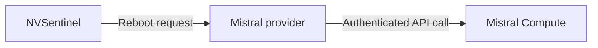

# NVSentinel provider for Mistral Compute

Reboot Mistral Compute nodes through [NVSentinel](https://github.com/NVIDIA/NVSentinel)'s automated remediation workflow. Install this provider alongside NVSentinel using Helm and authenticate to Compute with Kubernetes OIDC workload identity.

## How it works

NVSentinel quarantines and drains an unhealthy node, then asks the provider to reboot it through the Compute API. The provider confirms completion when the original node returns with a new boot ID and is Ready.



Supports NVSentinel **v1.26.0**. Reboot is supported; node replacement and breakfix are not yet available.

## Installation

Follow the **[installation guide](docs/installation.md)** to create the Compute service account and OIDC trust, configure TLS, and connect NVSentinel.

Start with the [example values](docs/provider-values.yaml), then install a published chart version:

```sh
helm upgrade --install nvsentinel-provider-mistral \
  oci://ghcr.io/mistralai/charts/nvsentinel-provider-mistral \
  --version "$PROVIDER_VERSION" \
  --namespace nvsentinel \
  --values values.local.yaml --wait
```

OIDC uses short-lived credentials. An [API-key option](docs/installation.md#alternative-use-an-api-key) is also available.

## Documentation

- [Service accounts and permissions](docs/permissions.md)
- [Configuration reference](docs/configuration.md)
- [NVSentinel integration](docs/integration.md)
- [Operations and troubleshooting](docs/operations.md)

Licensed under [Apache 2.0](LICENSE).
