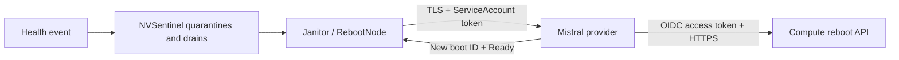

# NVSentinel provider for Mistral Compute

[](https://github.com/mistralai/nvsentinel-provider-mistral/actions/workflows/ci.yaml)
[](https://github.com/mistralai/nvsentinel-provider-mistral/actions/workflows/publish.yaml)
[](LICENSE)
[](https://github.com/NVIDIA/NVSentinel/tree/v1.26.0)

**Connect NVSentinel's node-remediation workflow to the Mistral Compute reboot API.**

Run this independent Go provider alongside NVSentinel. Janitor keeps its quarantine, drain, and `RebootNode` workflow; this provider handles authenticated reboot requests and checks that the original node returns on a new boot. No NVSentinel fork is required.

**[Install with OIDC →](docs/installation.md)** · [Permissions](docs/permissions.md) · [Configuration](docs/configuration.md) · [Operations](docs/operations.md) · [CI and releases](docs/releasing.md)

> **Development status:** the repository is private while the first release is prepared. No release is advertised until both its image and chart have been published. The documented integration targets NVSentinel **v1.26.0**.

## How it works



- **Kubernetes workload identity:** exchange a short-lived, audience-bound ServiceAccount token through a Compute OIDC trust. No long-lived Compute key is needed in this mode.
- **Explicit machine mapping:** an administrator-managed, protected label maps each Kubernetes Node to its Compute bare-metal host.
- **Durable retry protection:** a Kubernetes journal coordinates replicas and records a reservation before the reboot request.
- **Verified completion:** HTTP 204 means initiation. Completion requires the same Node UID, a changed boot ID, and `Ready=True`.
- **Packaged for Kubernetes:** a Helm chart, scoped RBAC, TLS, nonroot containers, amd64/arm64 images, and GHCR release automation.

| Supported now | Scope |
| --- | --- |
| Reboot | `SendRebootSignal` and `IsNodeReady` |
| Compute authentication | Federated OIDC workload identity or an existing API-key Secret |
| Janitor authentication | Kubernetes TokenReview with an exact ServiceAccount identity and audience |
| Termination / breakfix | Not implemented; unsupported CSP RPCs return `Unimplemented` |

The Compute API has no reboot idempotency key or operation-status API. A crash or ambiguous response can therefore require [operator recovery](docs/operations.md#unconfirmed-outcomes). The provider does not claim exactly-once delivery.

## Install

The [installation guide](docs/installation.md) walks through the whole setup:

1. Check NVSentinel, Kubernetes issuer, NodeRestriction, TLS, and registry prerequisites.
2. Create a project-scoped Compute service account with **`nodes` level `update`**.
3. Trust the provider's exact Kubernetes ServiceAccount subject, issuer, and dedicated audience.
4. Install the provider, verify OIDC and permissions without rebooting a node, and configure the protected node mapping.
5. Point Janitor's reboot controller at the provider.

Example OIDC values, after creating the trust:

```yaml
compute:
  endpoint: https://compute.example.invalid
  project: example
  region: example-region
  auth:
    mode: workloadIdentity
    workloadIdentity:
      clientId: "<clientId returned by the OIDC trust>"
      tokenUrl: "<tokenUrl returned by the OIDC trust>"
      audience: mistral-compute

serviceAccount:
  name: nvsentinel-provider-mistral
```

This is an excerpt. Copy the complete [OIDC values example](docs/provider-values.yaml) for TLS, Janitor identity, and private-registry settings. API-key users can follow the [alternative installation](docs/installation.md#alternative-use-an-api-key).

Once a version has been published:

```sh
helm upgrade --install nvsentinel-provider-mistral \
  oci://ghcr.io/mistralai/charts/nvsentinel-provider-mistral \
  --version "$PROVIDER_VERSION" \
  --namespace nvsentinel \
  --values values.local.yaml --wait
```

Before the first release, follow the guide's [development installation](docs/installation.md#4-install-the-provider). Installing the provider alone does not change Janitor routing.

## Permissions at a glance

| Identity | Required access |
| --- | --- |
| Compute service account | One project binding to a role with `nodes: { level: update, scope: all }` |
| Provider Kubernetes ServiceAccount | Get Nodes; get/patch RebootNodes; create TokenReviews; get/create/update journal ConfigMaps in its namespace |
| Janitor Kubernetes ServiceAccount | Its existing NVSentinel permissions and an audience-bound token accepted by this provider |
| Installation administrator | Create the Compute role, service account, and OIDC trust; install Helm/RBAC/TLS and set trusted node labels |

OIDC authenticates the provider as the Compute service account. **The Compute role binding authorizes the reboot.** See [exact permissions and bootstrap request bodies](docs/permissions.md).

## CI and packages

Every PR runs Go formatting, dependency consistency, vet, race tests, real Kubernetes API-server tests, Helm lint/render checks, workflow lint, and an amd64/arm64 container build. Token-exchange tests use local synthetic servers. CI never contacts a live Compute project.

| Trigger | Result |
| --- | --- |
| Pull request | Validation and container build; no package push |
| Merge to `main` | Validation, then `edge` and commit-tagged GHCR images |
| `vMAJOR.MINOR.PATCH` tag | Validation and chart-version matching, then versioned image and OCI Helm chart |

Images include build provenance and an SBOM. Actions and base images are pinned; Dependabot proposes updates weekly. See [CI checks, package paths, release steps, and visibility](docs/releasing.md).

## Develop

Use Go **1.27.0**, Helm **3.18.6+**, and Python 3:

```sh
python3 -m venv .venv
.venv/bin/pip install -r charts/tests/requirements.txt
make PYTHON=.venv/bin/python check
make workflow-check
make build
```

The integration suite starts a local Kubernetes API server and uses NVSentinel's pinned `RebootNode` CRD. It does not reboot hardware. See [contributing](CONTRIBUTING.md) for the development workflow and [configuration](docs/configuration.md) for runtime settings.

Licensed under [Apache 2.0](LICENSE).
